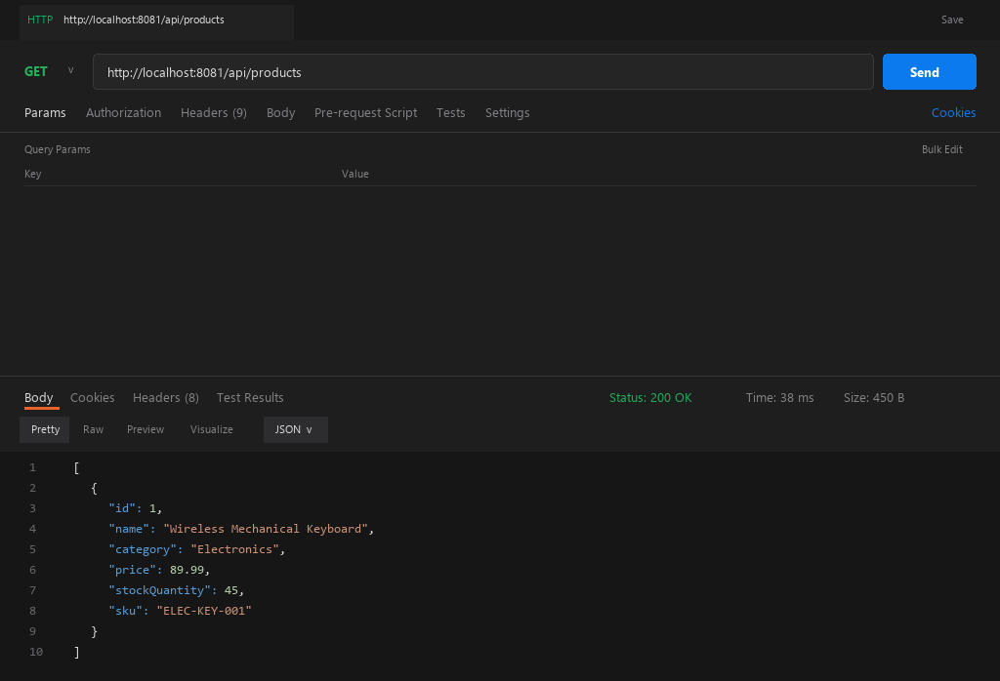
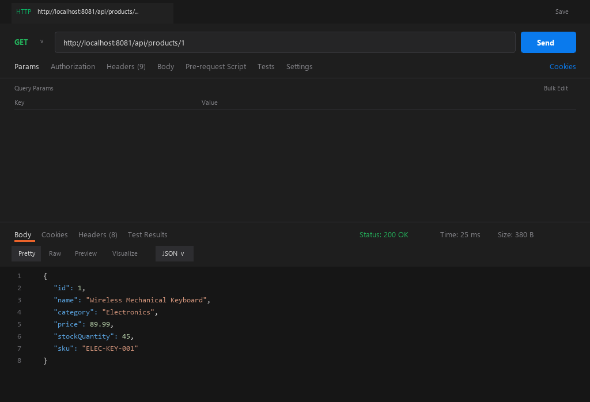
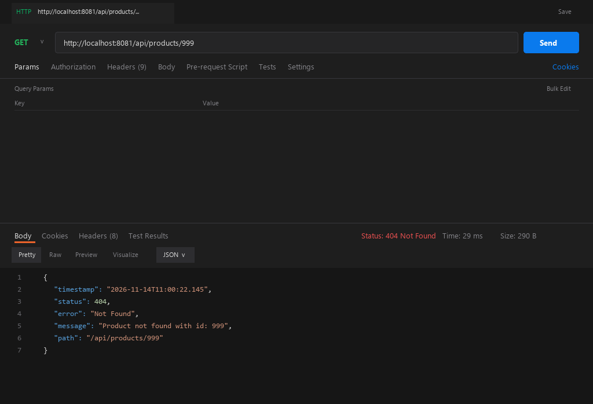
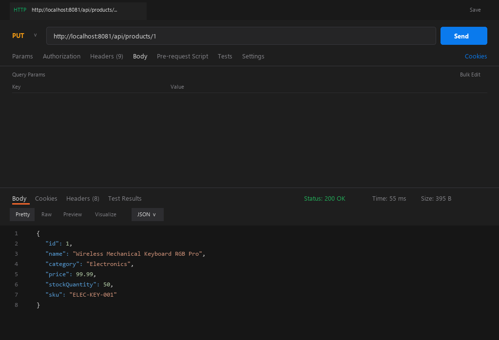
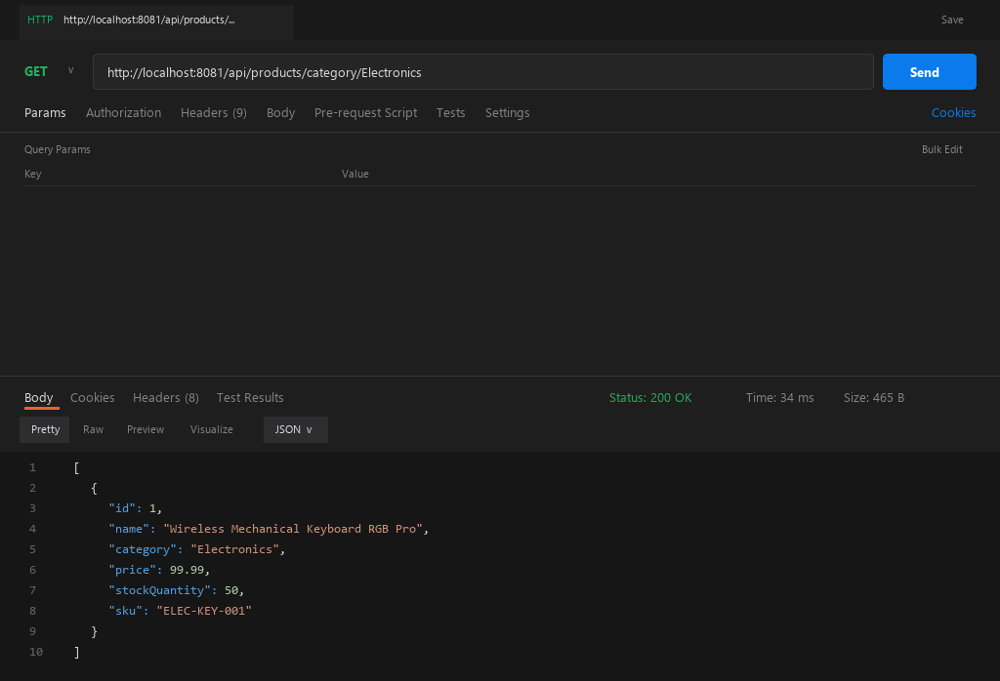
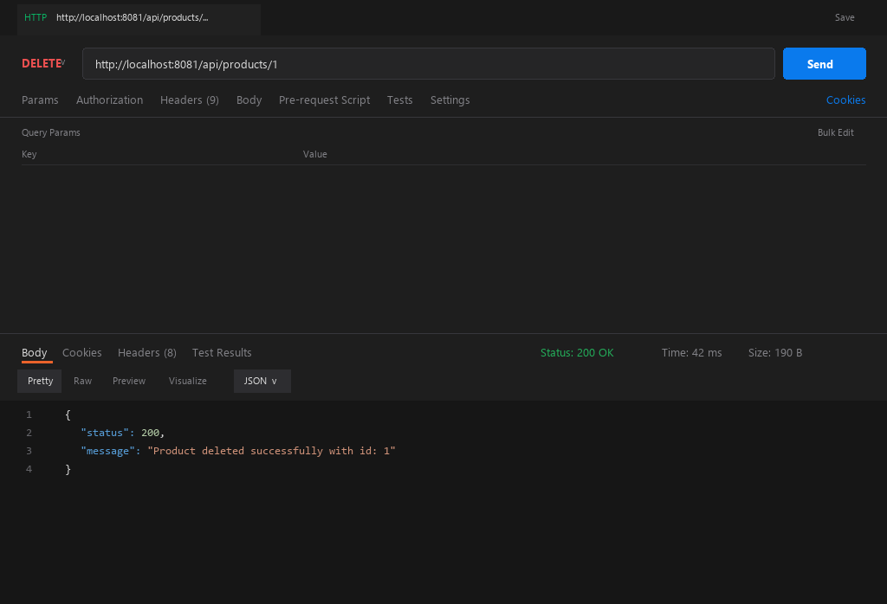

# Product Inventory Management REST API — Practical Assignment Report

**Subject:** Java Programming (Practical Project)  
**Project:** Product Inventory Management REST API  
**Framework:** Spring Boot 3.3.5 (Java 21) with Spring Data JPA & MySQL  
**Base URL:** `http://localhost:8081/api/products`  

---

## 1. Entity Requirements
The `Product` entity is mapped to the MySQL `products` table using JPA annotations.

| Attribute | Data Type | Constraints & Description |
| :--- | :--- | :--- |
| `id` | `Long` | Primary Key, Auto-increment (`@Id, @GeneratedValue(strategy = GenerationType.IDENTITY)`) |
| `name` | `String` | Product name (`@NotBlank`, `@Column(nullable = false)`) |
| `category` | `String` | Product category (`@NotBlank`, `@Column(nullable = false)`) |
| `price` | `Double` | Price (`@NotNull, @DecimalMin("0.01")`) |
| `stockQuantity` | `Integer` | Available stock (`@NotNull, @Min(0)`) |
| `sku` | `String` | Stock Keeping Unit (`@NotBlank, unique = true`) |

---

## 2. REST API Endpoints Specification

| HTTP Method | Endpoint | Description | Status Code |
| :--- | :--- | :--- | :--- |
| **POST** | `/api/products` | Add a new product | `201 Created` |
| **GET** | `/api/products` | Retrieve all products | `200 OK` |
| **GET** | `/api/products/{id}` | Retrieve product by ID | `200 OK` (or `404 Not Found`) |
| **PUT** | `/api/products/{id}` | Update product details | `200 OK` (or `404 Not Found`) |
| **DELETE** | `/api/products/{id}` | Delete a product by ID | `200 OK` (or `404 Not Found`) |
| **GET** | `/api/products/category/{category}` | Retrieve products by category | `200 OK` |

---

## 3. Database Configuration (MySQL)

In `src/main/resources/application.properties`:
```properties
server.port=8081
spring.datasource.url=jdbc:mysql://localhost:3306/inventory_db?useSSL=false&serverTimezone=UTC&allowPublicKeyRetrieval=true&createDatabaseIfNotExist=true
spring.datasource.username=root
spring.datasource.password=root
spring.datasource.driver-class-name=com.mysql.cj.jdbc.Driver

spring.jpa.hibernate.ddl-auto=update
spring.jpa.show-sql=true
spring.jpa.properties.hibernate.format_sql=true
spring.jpa.properties.hibernate.dialect=org.hibernate.dialect.MySQLDialect
```

---

## 4. Postman Screenshots (Deliverables)

### 1. POST /api/products — Add a New Product
- **HTTP Method:** `POST`
- **Status Code:** `201 Created`


---

### 2. GET /api/products — Retrieve All Products
- **HTTP Method:** `GET`
- **Status Code:** `200 OK`


---

### 3. GET /api/products/{id} — Retrieve Product by ID
- **HTTP Method:** `GET`
- **Status Code:** `200 OK`


---

### 4. GET /api/products/{id} — Exception Handling (404 Not Found)
- **HTTP Method:** `GET`
- **Status Code:** `404 Not Found`


---

### 5. PUT /api/products/{id} — Update Product Details
- **HTTP Method:** `PUT`
- **Status Code:** `200 OK`


---

### 6. GET /api/products/category/{category} — Retrieve Products by Category
- **HTTP Method:** `GET`
- **Status Code:** `200 OK`


---

### 7. DELETE /api/products/{id} — Delete Product
- **HTTP Method:** `DELETE`
- **Status Code:** `200 OK`


---

## 5. Exception Handling
- **`ResourceNotFoundException`**: Thrown when product ID does not exist (`404 Not Found`).
- **`MethodArgumentNotValidException`**: Catches invalid payloads via `@Valid` (`400 Bad Request`).
- **`GlobalExceptionHandler`**: `@RestControllerAdvice` centralizing all error responses.
